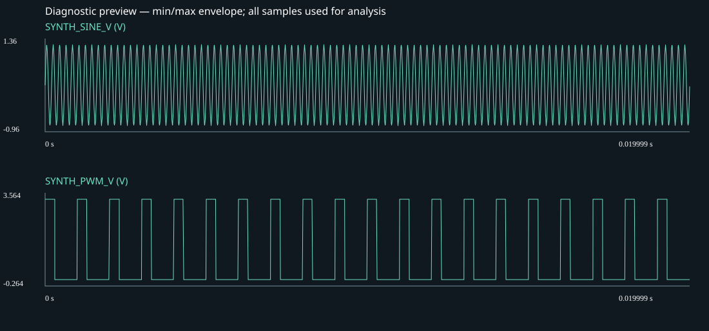

# ScopeAgent 分析报告

模式：local_rules；执行状态：completed；限值结果：pass。

## 确定性测量

| 通道 | Vpp (V) | RMS (V) | 周期候选 (Hz) | 阈值占空比 (%) |
| --- | ---: | ---: | ---: | ---: |
| SYNTH_SINE_V | 2 | 0.734864 | 5000 | 50 |
| SYNTH_PWM_V | 3.3 | 1.80911 | 1000 | 30.1 |

## Agent 说明

本次使用可复现规则流程，未调用外部模型。

已分析 2 个通道；用户限值结果：pass。结论限于导入采样记录。

引用证据：E001, E002, E003

## 测量边界与补测

限值只判定本次采样记录。元数据为采集者声明，探头、带宽、校准与采集间隙尚需核实。

### SYNTH_SINE_V

- ADC range, probe calibration, analog bandwidth and acquisition gaps outside this record are unknown.

### SYNTH_PWM_V

- ADC range, probe calibration, analog bandwidth and acquisition gaps outside this record are unknown.

补测计划 E003（未执行）：

- Acquire more samples across edges; verify analog/probe bandwidth before judging physical rise time.
- Confirm probe ratio, voltage units, coupling, bandwidth, trigger, and capture mode.
- Retain raw samples and metadata; screen points alone may miss narrow events.
- Use hardware triggering for rare events; polling does not establish absence of glitches.

CSV SHA-256：`2a70f4301adf4c7319d1cbdffc8ed91e90153334f297c69e6fe87cd59d633c3b`

完整边界、限值逐项结果和参考差值见 analysis.json 与 trace.jsonl。
