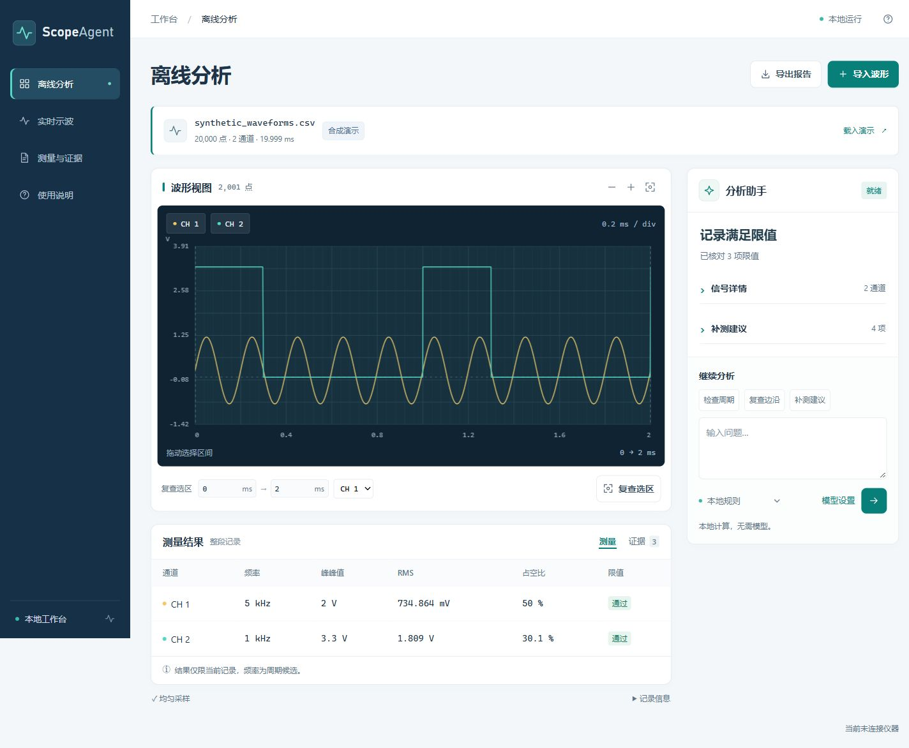
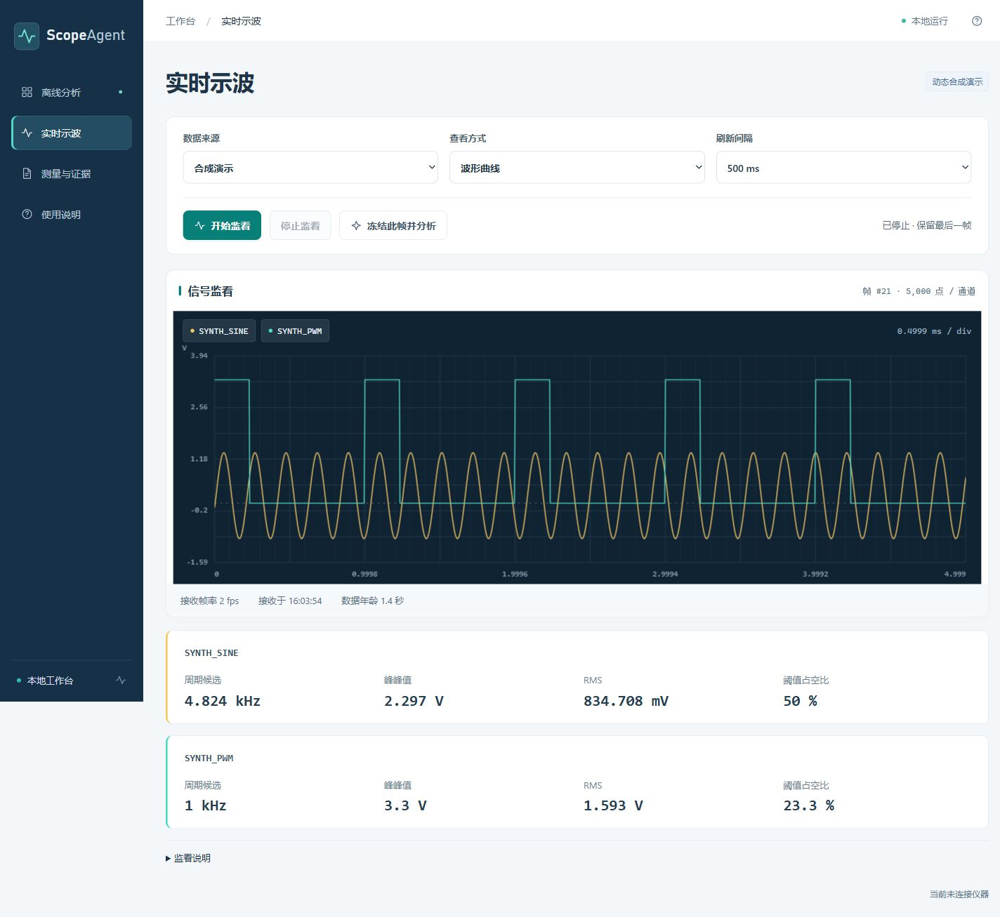

# ScopeAgent 使用指南

[返回项目首页](../README.md)

ScopeAgent 用于分析电压随时间变化的采样记录。导入波形后，可以查看曲线、计算测量、复查局部区间、对比参考记录、评估测试限值，并保存可追溯的分析报告。

新增 **实时示波**：无设备可运行动态合成演示；有设备时，从扫描结果选择实际设备，或填地址读取身份，再按型号匹配适配器。当前波形 / 原屏截图适配器为 RIGOL MSO5000；其他厂商型号可以尝试识别，但没有适配器时不启用监看。曲线可以冻结一帧后交给 Agent 分析。真实设备尚未验收。

默认使用本地规则流程。配置模型服务后，可由模型选择分析工具、组织解释与补测建议。**使用界面和分析 CSV 不需要示波器、API Key、Node.js 或前端构建工具。**

当前版本为 **0.2 开发版**：本地界面与离线分析已验证，模型通信通过本机模拟服务测试，仪器适配器通过假设备测试；真实示波器连接和外部模型服务尚未验收。



## 目录

- [1. 使用前需要准备什么](#1-使用前需要准备什么)
- [2. 环境准备与首次启动](#2-环境准备与首次启动)
- [3. 图形界面的详细操作](#3-图形界面的详细操作)
- [4. 输入文件的格式](#4-输入文件的格式)
- [5. 命令行使用方法](#5-命令行使用方法)
- [6. 配置模型分析](#6-配置模型分析)
- [7. 可选示波器采集](#7-可选示波器采集)
- [8. 报告、证据与文件保存](#8-报告证据与文件保存)
- [9. 常见问题](#9-常见问题)
- [10. 验证方式与能力边界](#10-验证方式与能力边界)

## 1. 使用前需要准备什么

### 1.1 按使用方式选择条件

| 使用方式 | 必要条件 | 不需要准备 |
| --- | --- | --- |
| 体验内置演示 | Python 3.12+、NumPy、支持 Canvas 的现代浏览器 | 真实波形、示波器、模型账号 |
| 体验动态实时演示 | 与内置演示相同 | 设备、硬件依赖、模型账号 |
| 分析自己的 CSV | 上述条件，以及符合第 4 节格式的 CSV | 示波器实时连接、API Key |
| 参考对比 / 限值判断 | 额外准备参考 CSV / 限值 JSON，二者均可单独使用 | 模型服务 |
| 模型自主分析 | 兼容 Chat Completions 且支持 function tools 的服务、模型名称，及服务要求的 API Key | 仪器控制权限 |
| 从 MSO5000 采集 | 独立 Python 3.14+ 环境、pymso5000 0.2.0、可访问的兼容示波器与 VISA 链路 | 不属于离线/UI 必选条件 |

离线依赖见 [requirements-offline.txt](../requirements-offline.txt)，当前声明为 `numpy>=1.24`。硬件依赖见 [requirements-hardware.txt](../requirements-hardware.txt)。不要为了体验界面而安装硬件依赖。

### 1.2 电脑、目录与网络

- 下文命令按 **Windows PowerShell** 编写，当前已验证的离线解释器为 Python 3.12；其他操作系统未进行专项验证。
- 项目目录需要可读写，服务会在项目内的 `.ui-data` 暂存导入记录。至少为导入文件、解析后的数组和报告留出磁盘及内存空间；文件大小不等于实际内存占用。
- 默认端口为 `8765`。本地界面只监听 `127.0.0.1`，供当前电脑访问，不是公网或局域网多人服务。
- 已安装 NumPy 时，离线模式不要求互联网；首次安装依赖和访问外部模型服务需要相应网络。
- 不要只复制 `ui` 目录或双击 `index.html`：页面需要由 Python 服务提供分析接口。

## 2. 环境准备与首次启动

### 2.1 进入项目目录并检查解释器

在 PowerShell 中执行：

```powershell
python --version
python -c "import sys; print(sys.executable)"
python -c "import numpy; print(numpy.__version__)"
```

所有命令都在项目根目录执行，即 ui_server.py 所在目录。最后一行能输出 NumPy 版本，且 Python 满足离线版本要求时，可以直接跳到第 2.3 节。

如果出现 `python` 无法识别，应先准备可用的 Python 解释器；如果 `import numpy` 失败，再按下一节安装到所用解释器中。

### 2.2 可选：创建独立离线环境

下面使用原生 Windows Python 的虚拟环境路径，避免依赖安装到其他项目中：

```powershell
python -m venv .venv-offline
.\.venv-offline\Scripts\python.exe -m pip install -r requirements-offline.txt
.\.venv-offline\Scripts\python.exe -c "import numpy; print(numpy.__version__)"
```

后续命令中的 `python`，统一换成 `.\.venv-offline\Scripts\python.exe` 即可，无须执行激活脚本，也无须修改 PowerShell 执行策略。

使用 MSYS2/MinGW 等解释器时，虚拟环境目录布局可能不同，请使用实际的 Python 路径。不要混用一个解释器安装依赖、另一个解释器启动项目。

### 2.3 启动界面

**文件夹内双击入口：**

- [打开网页工作台.cmd](../打开网页工作台.cmd)：启动本地服务并在默认浏览器打开工作台。优先使用项目内 `.venv-hardware`，其次 `.venv-offline`，否则使用 PATH 中的 `python`；不会自动安装依赖。已经有本项目服务运行时，通过健康接口确认后复用，避免重复启动。
- [网页入口.url](../网页入口.url)：直接打开默认地址 `http://127.0.0.1:8765/`，适合服务已经运行的情况；它本身不会启动 Python。

首次启动仍需要满足依赖条件。启动新服务的终端要保持运行；正常退出可按 Ctrl+C。若使用其他端口，请按下方命令启动并访问实际地址，默认快捷方式固定指向 8765。

使用已有环境：

```powershell
python ui_server.py
```

或使用上一节的独立环境：

```powershell
.\.venv-offline\Scripts\python.exe ui_server.py
```

终端出现以下地址后，在浏览器打开 [本地工作台](http://127.0.0.1:8765)：

```text
ScopeAgent UI: http://127.0.0.1:8765
```

首次打开会加载合成演示并执行本地分析，不需要先上传文件。终端应保持运行；关闭浏览器标签不会停止服务。

如果已有同一服务在运行，可直接打开现有页面。需要另选端口时：

```powershell
python ui_server.py --port 8766
```

然后打开 `http://127.0.0.1:8766`。停止服务时，在启动它的终端按 `Ctrl+C`。停止前先导出需要保留的报告。

## 3. 图形界面的详细操作

### 3.1 用演示熟悉工作台

打开页面后，检查顶部记录名和“合成演示”标记：

- 演示正弦：5 kHz、2 Vpp，带 0.2 V 直流偏置。
- 演示 PWM：约 1 kHz、3.3 V，标称占空比 30%；现有演示文件的阈值测量约为 30.1%。
- 示例限值已随演示加载，“通过”仅指该合成记录满足示例限值。

这些不是实机测量。点击“载入演示”可返回合成记录视图；演示在本次服务中可能复用上次分析结果。

### 3.1.1 无设备体验实时波形

1. 在左侧导航点击 **实时示波**；窄屏中是波形图标。
2. 数据来源保留 **合成演示**，查看方式选 **波形曲线**。
3. 点击 **开始监看**。默认目标间隔 500 ms，每帧生成 5,000 个点 / 通道。正弦的幅度、频率和 PWM 占空比会缓慢变化；这是软件生成的独立帧，不是旧 CSV 循环播放，也不是仪器采样。
4. 曲线下方显示接收帧率、接收时刻和数据年龄。帧率取决于实际处理与传输，不能当作 ADC 采样率；长时间没有新帧会提示数据陈旧。点击通道标签可隐藏或显示曲线。
5. 点击 **停止监看**，停止生成并保留最后一帧。再次开始会创建新会话。
6. 点击 **冻结此帧并分析**，锁定当前显示的完整采样，停止监看并进入离线分析。可继续复查选区、查看证据、提问或导出报告。冻结过程先完成本地规则分析；不会自动调用付费模型。没有配置测试限值时不判断合格。

冻结帧的导出 ZIP 额外附带 `live-frame.csv` 和 `metadata.json`，可重新导入；记录帧号、会话标识、接收时刻和合成来源。每个会话仅短暂保留最近五帧用于冻结，页面滞后时可能提示该帧过期，此时刷新监看或停止后冻结最新帧。

监看期间来源、间隔、通道等配置暂时锁定，停止并断开后可修改。切回离线分析会请求停止监看。关闭标签页会尽力发送停止请求；浏览器异常退出时该请求不保证送达，必要时重新打开页面停止监看或正常关闭服务。



### 3.1.2 实时示波的实用操作

界面左侧的 **使用说明** 已提供可展开的连接与操作指南，无设备演示、连接准备、视图选择、冻结复查、排障和隐私各有独立章节。

**调试 PWM：** 先在示波器面板确认探头倍率、通道、时基、量程和触发，让画面包含足够的完整周期；在本项目选择该通道的波形曲线。手动改变被测板的工作状态，观察周期候选、峰峰值和阈值占空比。出现值得检查的帧时，点击“冻结此帧并分析”，再拖选区间或输入毫秒范围，复查原始采样并展开证据。选区至少四点，但可靠的周期判断通常需要更多完整周期；NORMal 屏幕点可能漏掉窄脉冲，边沿数值也可能受采样分辨率限制。

**对比两种工作状态：** 先冻结并导出正常状态，再重新监看、复现另一状态，冻结并导出第二帧。解压两份报告，将第二帧 `live-frame.csv` 作为当前波形、第一帧作为参考 CSV，通过“导入波形”加载，并附上第二帧的 `metadata.json`。确保通道名称、探头倍率、耦合、时基及工况说明可比，再看标量差值；差值不能单独证明硬件故障。若需要合格判断，导入时另附测试限值 JSON，冻结本身不自动沿用静态演示的示例限值。

**查看设备当时显示的内容：** 使用“示波器原屏截图”，在仪器面板手动切换菜单或显示设置，再在工作台观察更新。它是周期截图，不能在网页上触屏操作，也不能从截图提取数值或冻结成采样分析。当前屏幕可能显示多个通道，但实时曲线首版一次只读取一个模拟通道。

**选择刷新速度：** 先用 500 ms 或 1 秒；如果链路或截图较慢，停止后改为 2 秒或 5 秒。最短 200 ms 是目标间隔，不保证每秒五帧。关注实际接收帧率和数据年龄；运行中超过 `max(3 秒, 3 × 目标间隔)` 没有新帧会标记陈旧。点击“停止监看”只停止电脑读取，不改变示波器本身的 RUN/STOP 状态；旧会话断开完成后才可改配置重连。

### 3.2 导入自己的波形

1. 点击右上角 **导入波形**。
2. 选择波形 CSV，或拖入文件选择区域。
3. 如需对比或判断限值，展开 **参考记录与测试条件**，分别选择：
   - 参考波形 CSV：用于相同通道名称的标量指标对比。
   - 测试限值 JSON：定义允许的幅度、频率等范围。
   - 采集说明 JSON：记录仪器、探头、耦合和采集条件。
4. 点击 **导入并分析**，等待窗口关闭。
5. 核对记录名、点数、通道数，以及“有参考记录”等提示。

UI 上传的所有文件合计不超过 **32 MiB**，每份 JSON 不超过 **128 KiB**。常见格式错误会显示原因；超长 CSV 字段等边界输入仍存在错误处理缺口，见审查记录。修正文件后可以重新导入。未提供测试限值时显示“未设限值”，不会默认判断合格。

参考对比只比较双方同名通道的测量指标，不会自动把两次波形对齐、叠加或推断因果。需要自行确认探头、单位、工况和时间窗是否可比较。

### 3.3 查看通道和缩放波形

- 点击波形上方的通道标签，显示或隐藏该通道；这只影响预览，不改变原始记录或整段测量。
- 点击 **放大时间范围 / 缩小时间范围**，改变当前显示窗口。
- 点击 **显示整段波形**，恢复全记录视图。
- 在波形上移动指针可查看时间和近似电压。带 `≈` 的指针读数来自预览点，不是正式测量结果。

曲线采用保留极值的包络预览，缩放时重新从原始数组生成显示点。测量始终使用对应区间的原始采样，不使用缩略图反推数值。

### 3.4 复查局部区间

1. 在波形区域横向拖动，选中时间段；也可以直接填写下方开始、结束时间。
2. 选择需要复查的通道。
3. 点击 **复查选区**。
4. 在右侧查看选区点数、峰峰值、RMS、周期候选，并在“证据”中展开选区复查结果。

**界面时间输入使用毫秒（ms），CSV 时间列使用秒（s）。** 例如 CSV 中 `0.001` 秒对应界面中的 `1` 毫秒。

选区必须位于当前记录的时间范围内，开始小于结束，且至少包含四个原始点。过短区间通常无法建立稳定周期；“未建立”不表示程序失败。局部测量与整段限值判断分开显示，复查不会自动把整段结论改成局部结论。

### 3.5 阅读测量和证据

左侧的「测量与证据」会跳到离线分析页下方的对应区域。它是导航入口，不会单独执行一轮分析；实时监看期间点击会请求停止电脑端监看。

分析助手中的「信号详情」「补测建议」、页面下方的「记录信息」默认折叠，点击标题可展开。选区复查和模型解释仍直接显示。

**测量**页签展示整段记录的通道频率候选、峰峰值、RMS、阈值占空比和限值状态。**证据**页签可展开每次工具调用的参数、结果和状态：

| 工具 | 作用 |
| --- | --- |
| `analyze_record` | 整段记录测量和质量提醒 |
| `inspect_interval` | 用原始点复查指定通道和时间段 |
| `compare_reference` | 当前与参考记录的指标、差值和相对变化 |
| `evaluate_limits` | 按用户提供的限值判断 |
| `propose_capture` | 给出补测计划，不执行仪器操作 |

证据编号如 `E001`，仅在本次分析轨迹中有效。新一轮分析会重新编号，不是跨记录的全局编号。

### 3.6 使用分析助手

1. 在 **继续分析** 输入问题，或点击“检查周期”“复查边沿”“补测建议”预填问题。
2. 选择分析方式。
3. 点击右箭头 **开始分析**。

两种方式的能力不同：

| 方式 | 行为 |
| --- | --- |
| 本地规则 | 执行固定测量、限值、可用参考对比和补测流程；文字用于记录目标，不保证理解任意自然语言问题 |
| 模型分析 | 根据问题选择受限工具并组织说明；需要第 6 节的配置，可能产生服务商费用 |

无论当前选择哪种分析方式，点击 **复查选区** 都会进行本地确定性测量。建议补测只生成步骤，界面不会据此连接或控制仪器。

### 3.7 导出报告并结束使用

点击 **导出报告**，浏览器会下载 `scope-agent-report.zip`。解压后阅读 `report.md`，或检查 JSON 和工具轨迹。每次分析更新的是当前记录的最近一份结果；如果需要保留多轮过程，请在每轮后分别下载、重命名保存。

刷新页面通常会回到演示；如果后台仍有正在运行的监看会话，页面会尝试重新附着。项目不提供导入记录的历史恢复入口。服务最多保留最近三份记录，演示也计入；旧记录可能被释放。不要把暂存区当作长期存档。

## 4. 输入文件的格式

### 4.1 波形 CSV

使用 UTF-8 编码、逗号分隔，第一行为唯一表头，例如：

```csv
time_s,CH1_V,CH2_V
0.000000,0.10,0.0
0.000001,0.12,3.3
0.000002,0.15,3.3
0.000003,0.18,0.0
```

这四行仅用于说明格式，不足以验证周期测量。正式分析建议先用内置的长记录演示确认流程。

| 规则 | 要求 |
| --- | --- |
| 时间列 | 名称严格为 `time_s`，单位秒；可以为负数，但必须逐点严格递增 |
| 通道列 | 1–8 个，以 `_V` 结尾，例如 `CH1_V`；单位伏特，名称不能重复 |
| 其他列 | 不接受额外说明列、索引列或重复表头 |
| 数值 | 每行列数一致；不接受缺失值、NaN、Inf 或非数字 |
| 点数 | 每份记录 4–1,000,000 点 |
| 大小 | CSV 解析器上限 128 MiB/文件；UI 另受所有上传文件合计 32 MiB 限制 |
| 处理原则 | 不自动排序、补点、重采样或猜测单位 |

厂商原始导出若带多行仪器说明、以毫秒为时间单位，或包含 ADC 码，应先正确转换。不能仅把 `time_ms` 改成 `time_s`，也不能仅把 ADC 列重命名为 `_V`。探头倍率与硬件库的标定换算需核实，避免重复乘倍率。

### 4.2 测试限值 JSON

保存为 JSON 对象，键使用 CSV 中的**完整通道名称**。例如对 `CH1_V` 检查 2 Vpp、5 kHz 附近的记录：

```json
{
  "CH1_V": {
    "vpp_v": {"min": 1.9, "max": 2.1},
    "frequency_hz": {"min": 4900, "max": 5100}
  }
}
```

每项至少提供 `min` 或 `max`，也可同时提供，边界包含等号，且 `min <= max`。仅接受有限数值；不接受把数字写成字符串或使用布尔值。未列出的通道和指标不会被评估；未知通道、拼错指标或无效范围会报错。

| 指标 | 含义 | 单位 |
| --- | --- | --- |
| `min_v` / `max_v` | 采样记录内最小 / 最大电压 | V |
| `vpp_v` | 采样最大值减最小值 | V |
| `mean_v` | 时间加权均值 | V |
| `rms_v` | 时间加权 RMS | V |
| `ac_rms_v` | 去直流后的 RMS | V |
| `frequency_hz` | 稳定阈值交叉间隔得到的周期候选频率 | Hz |
| `duty_cycle_pct` | 阈值占空比 | %，例如 30 表示 30% |

判定含义：

| 状态 | 含义 |
| --- | --- |
| `pass` / 通过 | 所有已配置指标都能建立并处于给定范围 |
| `fail` / 超出限值 | 至少一项可用指标越界 |
| `inconclusive` / 证据不足 | 没有已发现的越界，但至少一项指标无法建立 |
| `not_evaluated` / 未设限值 | 没有配置限值，不判断合格 |

若同时有越界项与不可建立项，整体结果为 `fail`。通过只针对本次采样和给定边界，不证明探头正确、没有混叠或产品已合格。

内置演示使用不同的通道名称，直接体验时应使用 [examples/limits.json](../examples/limits.json)，而不是照搬上面的 `CH1_V` 示例。

### 4.3 采集说明 JSON

该文件可选，用于保存背景信息。例如：

```json
{
  "source_kind": "imported_scope_csv",
  "synthetic": false,
  "instrument": {"model": "unknown", "firmware": "unknown"},
  "acquisition_mode": "unknown",
  "probe_ratio": null,
  "coupling": "unknown",
  "bandwidth_limit": "unknown",
  "trigger": "unknown",
  "calibration": "unknown"
}
```

只填写已经确认的信息；未知项使用 `null` 或明确写未知。metadata 是采集者声明，不会自动校准仪器、修改电压、补齐未知信息或证明采集可靠。项目不依赖其内容执行仪器指令。

## 5. 命令行使用方法

下文均在项目目录执行，`--output` 指定的目录必须不存在或为空。第二次运行请换新目录，避免覆盖已有结果。

### 5.1 完整离线演示

```powershell
python scope_agent.py demo/synthetic_waveforms.csv --limits examples/limits.json --metadata examples/metadata.json --output output-demo-agent
```

成功后会打印 `status: completed`、模式、工具调用数和输出位置。在 `output-demo-agent` 中查看第 8 节的五份产物。

### 5.2 分析自己的记录

先将命令中的文件名替换为实际存在的路径：

```powershell
python scope_agent.py "your_waveform.csv" --question "检查周期、幅度与采样限制，并说明需要补测什么" --output output-my-record
```

需要参考对比、限值和采集说明时：

```powershell
python scope_agent.py "your_waveform.csv" --reference "known_good.csv" --limits "your_limits.json" --metadata "your_metadata.json" --output output-compare
```

参考记录必须符合相同 CSV 规范；通道名称完全一致才会对比。各项文件均可使用带引号的绝对路径。

### 5.3 参数速查

| 参数 | 用途 |
| --- | --- |
| `csv` | 必填的当前记录路径 |
| `--output` | 必填的空输出目录 |
| `--question` | 分析目标，1–8000 个字符；不填时使用默认问题 |
| `--reference` | 可选的参考 CSV |
| `--limits` | 可选的测试限值 JSON |
| `--metadata` | 可选的采集说明 JSON |
| `--llm` | 显式启用模型模式 |
| `--base-url` / `--model` | 模型服务地址 / 名称，可覆盖同名环境配置 |

### 5.4 仅运行测量或生成新样本

仅做数值测量，不运行 Agent 工作流：

```powershell
python scope_analysis.py analyze "your_waveform.csv" --output output-measurements
```

这条入口输出 `analysis.json`、`report.md`、`waveform.svg` 三份文件，不执行模型、参考对比或用户限值评估。

重新生成明确标记的合成样本：

```powershell
python scope_analysis.py demo --output output-synthetic
```

生成目录内含 `synthetic_waveforms.csv`、`SYNTHETIC_DATA.txt` 和 `analysis` 子目录；不会改写原有演示。可将生成的 CSV 再导入界面。

## 6. 配置模型分析

### 6.1 前置条件

模型服务必须支持兼容 Chat Completions 的函数工具调用，且模型能按约定返回工具调用和最终 JSON。只支持普通聊天或图片识别，不等于能够驱动本项目工具。当前尚未对外部服务进行实测。

准备三项配置：

| 环境变量 | 内容 |
| --- | --- |
| `SCOPE_BASE_URL` | API 根路径，例如服务商给出的 `https://…/v1`；客户端会追加 `/chat/completions` |
| `SCOPE_MODEL` | 服务商提供的可用模型名称 |
| `SCOPE_API_KEY` | 服务要求的密钥；本机免鉴权服务可不设置 |

远端地址要求 HTTPS；HTTP 只允许 `localhost`、`127.0.0.1` 或 `::1`。不要把完整的 `/chat/completions` 路径再填进 base URL，不要在 URL 中夹带密码、查询参数或片段。

### 6.2 在页面添加模型（推荐）

1. 打开 **离线分析**，在分析助手下方点击 **模型设置**。即使“模型分析 · 未配置”不可选，此按钮也能打开。
2. 填写服务商提供的 **Base URL** 和准确的 **模型名称**。Base URL 使用 API 根路径，程序会追加 `/chat/completions`；不要把完整聊天接口再填进去。
3. 填写 API Key；本机免鉴权服务可留空。每次保存都需重新输入密钥，留空会清除之前的密钥，避免更换服务地址后误用旧密钥。
4. 点击 **保存设置**。模型分析选项立即可用，并自动选中；输入问题，再点击 **开始分析** 才会调用服务。
5. 如需恢复纯本地计算，选择 **本地规则**；也可在模型设置中点击 **停用模型**，移除本次服务的配置。

设置只保留在当前 Python 服务内存，不写文件或浏览器存储；同一个本机服务的多个页面共享设置。关闭弹窗会清空密钥输入框，重启服务后需重新填写；若启动时设置了环境变量，重启后会恢复从环境变量读取。保存只检查格式，不表示模型连接、权限和工具调用能力已经通过验证。

“离线分析”指分析导入或冻结的记录，与“实时示波”区分；其中选择模型分析仍会访问配置的服务，可能产生服务商费用。导入、冻结和选区复查默认使用本地计算，不会自动调用模型。

### 6.3 可选：设置环境变量并启动 UI

在准备启动服务的同一个 PowerShell 窗口设置，先把占位内容替换为服务商实际信息：

```powershell
$env:SCOPE_BASE_URL = "https://your-provider.example/v1"
$env:SCOPE_MODEL = "your-tool-capable-model"
$scopeKeyInput = Read-Host "输入模型 API Key" -AsSecureString
$env:SCOPE_API_KEY = [System.Net.NetworkCredential]::new("", $scopeKeyInput).Password
python ui_server.py
```

这里的 `.example` 地址不能直接使用。通过隐藏输入读取密钥，避免把密钥字面量写进命令历史；不要将真实密钥写入 README、源码或提交文件。项目不会自动读取 `.env` 文件。

如果 UI 已经在运行，应在原终端停止服务，再从已配置变量的窗口重新启动；在另一个终端设置变量不会更新旧进程。重启会结束原本机会话，先导出需要的报告。

打开页面，选择右下方 **模型分析**，输入问题后点击 **开始分析**。仅配置变量不会触发模型请求；默认仍是本地规则，文件导入也先执行本地流程。

### 6.4 命令行启用模型

```powershell
python scope_agent.py "your_waveform.csv" --llm --question "复查 CH1_V 在 1ms 到 2ms 的波形，并对比参考记录" --reference "known_good.csv" --output output-model
```

上述问题只适用于确实包含 `CH1_V` 且覆盖相应时间段的记录。服务地址和模型也可用 `--base-url`、`--model` 指定；API Key 仍从环境变量读取。

每轮分析最多六次模型请求、十二次工具调用，单次 HTTP 请求设置 45 秒超时，不自动重试付费请求。该预算不保证具体费用或完整流程的固定结束时间，应按所选服务的计费规则判断。

模型模式会发送问题、源文件名与摘要、工具测量结果及本轮工具轨迹，不会默认发送整份原始采样或任意本地文件。模型叙述未经独立核实，引用有效证据 ID 也不能保证每句解释正确；数值以确定性测量为准。

## 7. 可选示波器采集

提供实际设备扫描 / 身份识别、实时连接和命令行单次采集入口。身份识别接受 IPv4、带 IPv4 / 主机名的 TCPIP INSTR，以及完整 USB INSTR 资源；由所配置的 VISA 后端决定可达资源。**能识别不等于能采样：当前仅有 MSO5000 波形 / 截图适配器，其他型号标为未支持，不套用相同命令。** 实机、USB 驱动兼容性、吞吐和截图内容尚未验收；不会在打开页面时自动扫描或连接。

### 7.1 接入前准备

1. 准备独立 Python 3.14+ 环境；不要把硬件依赖装进用于离线 3.12 的环境。
2. 安装固定版本 `pymso5000==0.2.0`，并按该库配置适合仪器连接方式的 VISA 后端。安装成功不等于设备已连通。
3. 核对示波器型号、固件、实际 VISA 资源地址；使用 LAN 时，电脑应能访问示波器地址。
4. 确认通道为电压单位 V，探头倍率、接线、量程、耦合与待测信号条件适合当前测量。
5. 若使用 RAW，先在示波器上停止采集；项目不会代替用户发送 STOP/RUN。

若系统安装了 Windows Python Launcher，可按以下方式创建环境：

```powershell
py -3.14 -m venv .venv-hardware
.\.venv-hardware\Scripts\python.exe -m pip install -r requirements-hardware.txt
```

如果 `py` 不存在，使用已安装 Python 3.14+ 的完整可执行文件路径代替 `py -3.14`。本项目没有通过这些安装步骤验证当前电脑的硬件运行环境。

### 7.1.0 接网线、查 IP 与确认网段

推荐先通过路由器 / 交换机连接：示波器后面板 LAN 网口接入局域网，电脑接入同一可互通网络。电脑可有线或无线接入；访客 Wi-Fi、客户端隔离和不同 VLAN 可能阻断通信。

MSO5000 官方手册的路径为 **Utility → IO → LAN**。有路由器提供地址时，可使用 DHCP，等待网络配置成功，记录 LAN 页面显示的 IPv4 和 VISA 地址；不同固件界面文字可能不同。设备 IP 可能在重新获取 DHCP 地址后改变，以面板当前显示为准。[RIGOL 官方用户手册，第 20 章](https://www.rigol.com/dam/global/downloads/brochures/en/user-manual/oscilloscopes/MSO5000_UserGuide_EN.pdf)

例如面板实际显示 `192.168.1.100`，本项目可输入该 IP 或 `TCPIP::192.168.1.100::INSTR`。这个地址只是示例，不是自动发现结果。**工作台地址 `http://127.0.0.1:8765/` 属于电脑本身，不能把它当作设备 IP。** 不接受网页 URL 或原始 SOCKET 资源；USB 请原样填写 VISA 后端 / 厂商工具提供的完整 USB INSTR 地址，不能只填「USB」，可用性还取决于系统驱动与后端。

如果使用网线直连，双方可以配置同一网段的静态 IPv4。示例为专用有线网卡 `192.168.50.10`、示波器 `192.168.50.20`，子网掩码均为 `255.255.255.0`；地址必须不同，网段不能与现有网络冲突。示波器使用 Static IP 时，按手册关闭 DHCP 和 Auto IP。电脑只修改连接设备的有线网卡，同网段直连通常不需要网关 / DNS；先记录原设置，结束后恢复，不直接覆盖正在联网的网卡配置。

电脑可用 `ipconfig` 查看网卡配置，用 `ping` 后接实际设备 IP 辅助判断网络是否可达。ping 成功不证明 VISA 连接成功；ping 失败也可能只是 ICMP 被拦截。依赖安装、IP 可达和收到有效仪器数据是三个不同的检查阶段。

连接待测信号后，应先在示波器面板确认波形、已启用的通道、探头倍率、电压单位、时基、量程、耦合、触发，以及输入限值和接地方式。软件不会自动打开通道或替用户完成这些设置。

### 7.1.1 在界面连接并监看

1. 停止原离线服务，然后用安装硬件依赖的 **Python 3.14+** 启动同一个项目：

   ```powershell
   .\.venv-hardware\Scripts\python.exe ui_server.py
   ```

2. 打开本地界面 → **实时示波** → 数据来源选 **实际示波器**。点击 **扫描已连接设备**，再从 **选择实际设备** 中选择返回的厂商、型号、序列号和资源地址。设备列表来自实际身份响应。
3. 扫描没有发现设备时，可填写实际 IPv4、TCPIP INSTR 或完整 USB INSTR 地址，点击 **识别这台设备**。后台通过 `*IDN?` 读取身份；扫描最多检查八个后端列出的 LAN / USB 资源，不扫描整个网段。扫描结果取决于后端与网络发现支持，不能保证列出全部设备。未知型号可以显示身份，但没有适配器时无法开始监看；扫描读取失败也不会伪造型号。修改地址后必须重新识别。
4. 选择查看方式：

   | 查看方式 | 展示内容 | 能否冻结分析 |
   | --- | --- | --- |
   | 波形曲线 | 单个模拟通道 NORMal 采样，经前导参数换算的时间与电压；最多 10,000 点 / 帧 | 可以，使用该帧完整采样 |
   | 示波器原屏截图 | 仪器返回的屏幕图片，包含设备当时显示的网格、菜单和读数 | 仅查看，不从截图提取数值 |

5. 匹配适配器后再选择其可用视图和通道，设置目标刷新间隔。通道列表来自型号基础配置，例如 MSO5072 提供 CH1–CH2、MSO5354 提供 CH1–CH4；已授权升级的额外通道暂不自动探测。确认允许连接和读取后，点击 **开始监看**。开始时会再次核对设备身份，地址换成另一台设备会拒绝继续。首次收到有效帧后才显示正在监看；错误不会自动替换为合成数据。
6. 点击 **停止监看** 会等待当前读取退出并关闭连接。若显示正在断开，请等待完成后再修改配置或重连；关闭中的旧会话不能被新会话覆盖。

每个本地服务只运行一个监看会话，多个浏览器页共享它。后台顺序读取，不并发向同一设备发请求；一次 I/O 超时为 2 秒，完成整次读取和关闭可能更久。截图使用上游 `Scope.screenshot()`，不提供触屏控制。曲线读取可能改变波形传输源/模式并消耗错误队列，不承诺恢复配置；不会发送 RUN/STOP、Autoscale、Reset 或启用输出。监看停止不等于示波器停止采集。

这是周期读取而非视频串流、连续录波或无遗漏事件监测。接收时刻不是硬件触发时间；仪器停止时可能重复返回同一帧。罕见毛刺需配置仪器硬件触发，长记录或 RAW 仍使用下方单次采集入口。

### 7.2 获取一份记录

将 `YOUR_SCOPE_IP` 替换为设备实际地址，示例资源格式还需与实际 VISA 连接匹配：

```powershell
.\.venv-hardware\Scripts\python.exe instrument.py --resource "TCPIP::YOUR_SCOPE_IP::INSTR" --channel 1 --mode NORMal --allow-configuration --output capture-normal
```

成功时输出 `capture-normal/capture.csv` 和 `capture-normal/metadata.json`。把它们分别作为波形和采集说明导入 UI，或执行：

```powershell
python scope_agent.py capture-normal/capture.csv --metadata capture-normal/metadata.json --output output-captured-record
```

| 参数 | 条件 / 默认值 |
| --- | --- |
| `--resource` | 必填，显式指定 VISA 资源，不自动扫描或连接 |
| `--channel` | 1–4，默认 1；一次只采一通道 |
| `--mode` | `NORMal` 或 `RAW`，默认 `NORMal`，按此拼写传入 |
| `--max-points` | 4–1,000,000，默认 1,000,000；是接收上限，不保证返回该点数，也不会据此设置存储深度 |
| `--timeout-ms` | 100–60,000 毫秒，默认 10,000 |
| `--allow-configuration` | 必须显式传入，确认允许波形传输配置变化 |
| `--output` | 必填，目录必须不存在或为空 |

采集可能切换波形源、传输模式并消耗错误队列；项目不承诺自动恢复原配置。它不会自动 Autoscale、Reset 或启用信号输出。分次采集不同通道不能视为同时采样；NORMal 的显示点也不能直接当成深存储全量采样。

## 8. 报告、证据与文件保存

完整 Agent 的命令行输出目录和 UI 导出 ZIP 均包含：

| 文件 | 用途 |
| --- | --- |
| `report.md` | 可读报告：测量概览、Agent 说明、边界和补测建议 |
| `analysis.json` | 确定性计算、源文件 SHA-256、采集说明、限值及逐项判断 |
| `agent.json` | 分析方式、问题、完成状态、摘要与证据引用 |
| `trace.jsonl` | 逐次工具调用，每行一个 JSON 对象，可核对区间和参考差值 |
| `waveform.svg` | 全记录的诊断预览，不是仪器校准截图 |

UI 下载文件对应**最近一次分析结果**，其中 SVG 是全记录预览，不一定与当时缩放窗口一致。普通导入记录的 ZIP 不包含原始 CSV 或参考 CSV，请另行保存；实时冻结帧的 ZIP 额外包含 `live-frame.csv` 和 `metadata.json`。源文件哈希用于核对文件身份，不能替代备份。

UI 数据暂存于工作区 `.ui-data`，最近三份记录被淘汰或正常停止服务时清理。强制结束进程可能遗留临时文件；项目不自动恢复这些文件。该目录已被 Git 忽略，不应作为报告归档目录。

命令行 `scope_agent.py` 的进程退出码：

| 退出码 | 意义 |
| --- | --- |
| 0 | 流程完成；不等同于限值通过，`fail` 也可能是正常完成的分析结果 |
| 1 | 模型失败或预算耗尽，已有测量和轨迹仍会保存 |
| 2 | 输入、配置或文件操作等错误 |

## 9. 常见问题

| 现象 | 检查与处理 |
| --- | --- |
| `No module named numpy` | 对实际运行项目的解释器执行 `-m pip install -r requirements-offline.txt`，不要使用另一个环境的 pip |
| 找不到 ui_server.py / 输入 CSV | 确认已进入项目目录；检查文件是否存在，带空格的路径加双引号 |
| 端口被占用 / WinError 10048 | 检查是否已有工作台运行；可直接使用现有页面，或用 `--port 8766` 启动另一个端口 |
| 浏览器无法连接 | 检查终端进程是否仍运行，访问启动时打印的 HTTP 地址；不要使用 `file://` 打开 HTML |
| CSV 提示需要 time_s / _V | 对照第 4.1 节转换列名、单位、说明行和分隔符，不能只改单位标题 |
| 上传文件过大 | UI 合计上限 32 MiB；可在保证时间轴与信号语义的前提下分段。CLI 可读取最多 128 MiB 的单份 CSV，但仍受点数和内存限制 |
| 限值提示未知通道 | 使用 CSV 表头的完整名称；例如演示的 SYNTH_SINE_V 不等于 CH1_V |
| 频率 / 占空比未建立 | 检查是否为 DC、噪声、稀疏脉冲、周期不足或采样非均匀；不要强行把 FFT 峰当基频 |
| 非均匀采样提醒 | 项目会停用周期/FFT 等指标；优先核实采集空档，不能简单插值后宣称信号正常 |
| 选区复查失败 | 时间输入单位是 ms，范围须在原记录内、开始小于结束，至少包含四点 |
| 上升沿显示 sample_limited | 边沿附近点数不足，观测时间不能当真实物理边沿；需增加采样并核对模拟带宽 |
| 模型分析显示未配置 | 点击分析助手中的「模型设置」填写地址、模型名称和密钥，保存后即可选择；也可启动前配置环境变量。项目不会自动读取 .env |
| 模型 HTTP / 工具格式错误 | 核对根地址、模型权限、密钥、工具调用支持和最终 JSON 格式；先用本地规则确认数据有效 |
| 输出目录必须为空 | 换一个新的 `--output` 目录；不会自动覆盖或删除旧结果 |
| 刷新后记录不见了 | 当前不支持历史恢复，重新导入；重要结果应在刷新或停止前导出 |
| 记录已释放或服务重启 | 重新导入。服务最多保留最近三份记录，页面不能一直引用已淘汰的记录 |
| 硬件提示 Python / 库版本不符 | 使用独立 Python 3.14+ 与固定 pymso5000 0.2.0；离线 3.12 不具备本适配器的硬件运行条件 |
| 安装依赖后仍提示缺少硬件库 | 确认同一环境安装与启动；在新终端安装不会改变旧服务进程，先保存报告、停止旧服务，再用硬件环境启动 |
| 设备连接超时 | 依次查网线 / LAN 状态、面板当前 IP、电脑网段与隔离策略、资源类型、VISA 后端及其他程序的设备会话；不要通过关闭整个防火墙排障 |
| 实时帧号增长，波形却不变化 | 稳定信号可能看起来相同；仪器停止采集或触发未更新时也可能重复返回旧记录。核对设备面板，本项目不会自动 RUN |
| 实时数据年龄持续增长 | 读取中断或链路变慢可能使最后一帧滞留；结合错误信息排查，停止后增加目标间隔再重试，不把旧图当新采集 |
| 截图不能冻结 / 帧已过期 | 截图无原始数值，停止后切到曲线；过期帧则停止并等待最后一帧显示再冻结，缓存只保留最近五帧 |
| 实时曲线提示点数超限 | 核对 NORMal 返回点数；当前上限 10,000 点 / 帧，长记录和 RAW 使用命令行单次采集，不把超量数据静默截断 |
| 提示会话运行中或正在关闭 | 等旧会话断开后再开始；多个页面共享一个监看会话，暂不支持多人各自连接 |
| RAW 无法采集 | 先确认仪器已经停止采集，再核对型号、固件、VISA 后端与库的能力；本项目不自动改为停止状态 |

## 10. 验证方式与能力边界

### 10.1 本地检查

```powershell
python -m unittest -v
python ui_server.py --help
python scope_agent.py --help
python scope_analysis.py --help
python instrument.py --help
```

2026-10-20 增加模型设置后共有 72 项自动检查：65 项通过，7 项为审查中其他已确认缺陷的预期失败。非法密钥保护已修复并转为普通通过。`OK (expected failures=7)` 不表示全部功能通过。详细问题、复现方法、浏览器证据、性能数据及尚未验证的部分见 [项目审查与测试记录](../docs/REVIEW.md)。可运行 `python -m unittest test_review -v` 单独检查本轮用例。

现有覆盖包括数值测量、异常输入、采样空档、限值判断、工具预算、模拟模型通信、假仪器与本地 HTTP 导入/复查/导出，以及动态帧、截图、冻结帧哈希与重导入、VISA 身份发现、未知型号与通道限制、身份变化拒绝和网页入口启动 / 复用。

这些检查不会连接真实仪器，不需要真实模型密钥，也不证明外部服务质量、固件兼容性或测量校准准确率。安装依赖、外部模型调用与实机采集需在对应环境另行验证。

### 10.2 解释结果时的限制

- 周期频率是基于阈值交叉的候选，不是对任意波形的已证实基频。
- 正弦波也可得到阈值占空比，该指标不能独自证明波形是 PWM。
- FFT 输出 Hann 窗主峰频点，不自动提供可靠 THD、ENOB 或协议诊断。
- 采样间隙、模拟带宽、探头负载、接地与校准会影响结论。没有观察到毛刺，不代表毛刺不存在。
- 不支持从截图反推准确采样、完整抖动分析、协议解码、自动补测闭环或对任意电路给出唯一根因。

进一步了解实现和资料边界：

- [详细开发文档](../docs/DEVELOPMENT.md)
- [仪器资料来源、复用边界与整理记录](../docs/SOURCES.md)
- [合成演示报告](../demo/agent/report.md)、[工具轨迹](../demo/agent/trace.jsonl)、[波形预览](../demo/agent/waveform.svg)
